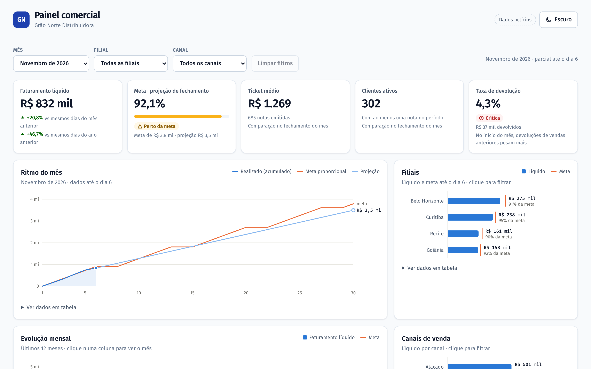
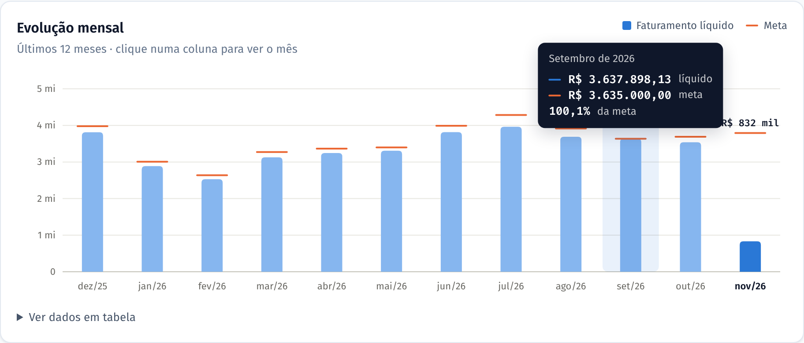
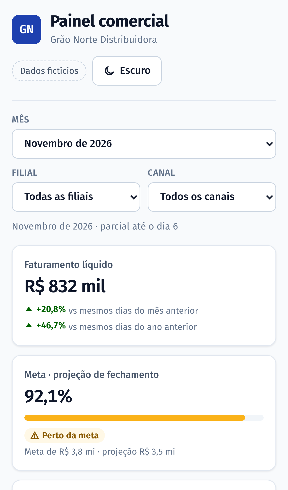
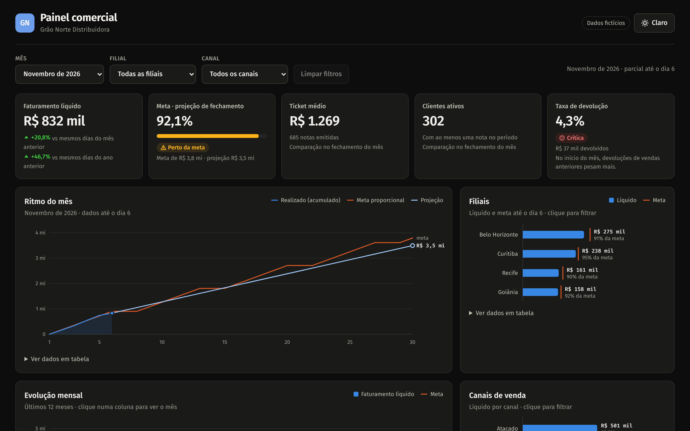

# Painel Comercial · Grão Norte Distribuidora

**Faturamento, meta e ritmo de vendas em uma tela só, atualizado a partir dos dados do ERP.**

> Projeto de portfólio. A Grão Norte Distribuidora é fictícia e todos os números foram gerados por um script, com padrões realistas de sazonalidade, crescimento, mix de produtos e devoluções.

🔗 **Demo:** _link da Netlify_ · 📱 funciona no celular · 🌙 tema claro e escuro



---

## O problema

Em distribuidoras com várias filiais e canais, a pergunta do dia a dia é sempre a mesma: **"vamos bater a meta este mês?"**. A resposta costuma depender de planilhas montadas à mão a partir de relatórios do ERP, que:

- chegam atrasadas, quando já não dá tempo de reagir;
- comparam o mês em andamento (incompleto) com meses fechados, o que distorce qualquer variação;
- não mostram onde está o problema: qual filial, qual canal, qual produto.

## A solução

Um painel que transforma o relatório de vendas em respostas diretas:

| Pergunta do gestor | Onde o painel responde |
|---|---|
| Vamos bater a meta? | **Projeção de fechamento** pelo ritmo dos dias úteis, com status (no ritmo / perto / abaixo) |
| Estamos vendendo mais ou menos? | Variação **comparando os mesmos dias** do mês e do ano anteriores, não o mês inteiro |
| Qual filial está puxando para baixo? | Ranking de filiais contra a **meta proporcional** até hoje |
| De onde vem o faturamento? | Canais, mix de categorias, produtos e clientes que mais compram |
| As devoluções estão sob controle? | Taxa de devolução com faixa de alerta |

Clicar numa filial, num canal ou num mês aplica o filtro, e a visão pode ser compartilhada por link (os filtros ficam na URL).

<p>
  
  
</p>



## Como funciona

```
pipeline/gerar_dados.py        pipeline/transformar.py             web/ (React)
──────────────────────►  CSV  ─────────────────────────►  JSON  ─────────────►  painel
dados fictícios no             regras de negócio com pandas,        só lê e exibe:
formato de um ERP              agregadas por filial × canal × mês   indicadores e gráficos
```

- **Python + pandas (`pipeline/`)**: concentra as regras de negócio — faturamento bruto, devoluções na data da devolução, líquido, ticket médio e clientes ativos — e pré-calcula cada combinação de filtro. Num projeto real, `gerar_dados.py` é substituído pela leitura do relatório do ERP; o restante não muda.
- **React + TypeScript (`web/`)**: site estático, rápido e sem servidor. Calcula só o que é de exibição: comparações, projeção e atingimento.
- **Gráficos em SVG feitos à mão**, sem biblioteca: barras de até 24 px com ponta arredondada, um eixo por gráfico, rótulos seletivos, tooltip em tudo e **versão em tabela** de cada gráfico.
- **Cores validadas para daltonismo** nos dois temas (azul = realizado, laranja = meta), com status sempre acompanhado de ícone e texto.

## Qualidade

Números de painel precisam estar certos. Por isso o projeto tem duas camadas de teste, rodando no GitHub Actions a cada push:

- **Pipeline (pytest, 12 testes):** o total do painel fecha com os dados brutos; filiais e canais somam o total; o diário soma o mensal; a meta da empresa é a soma das filiais; a geração é determinística.
- **Painel (Vitest, 17 testes):** contas conferidas à mão para ticket, taxa de devolução, atingimento, **projeção pelos dias úteis**, comparação "mesmos dias" e meta proporcional.

## Como foi construído

Desenvolvido com **IA como copiloto** (Claude Code), com as decisões e a validação sob controle humano: cada regra de negócio tem teste; as cores passaram por um validador de acessibilidade; e o painel foi conferido em navegador real, no desktop e no celular, nos dois temas. A IA acelera a escrita; a responsabilidade pelos números continua sendo de quem entrega.

## Rodando localmente

Requisitos: Python 3.10+ e Node 22.12+.

```bash
pip install -r pipeline/requirements.txt
python -m pytest pipeline/tests          # testes do pipeline

cd web
npm install
npm run dados                            # gera os dados e o JSON do painel
npm test                                 # testes do painel
npm run dev                              # http://localhost:5173
```

## Publicando

O `netlify.toml` já está configurado: na Netlify, **Add new project → Import an existing project**, escolha este repositório e pronto. O build gera os dados, roda os testes e publica o site.

## Adaptando para a sua empresa

O painel foi pensado para ser reaproveitado: trocando o gerador de dados pela leitura do relatório de vendas do seu ERP (CSV ou Excel), os mesmos indicadores passam a mostrar a sua operação. Para dados sensíveis, ele também pode rodar só na rede interna, sem publicação na internet.

---

Feito por [Eduardo Torres](https://github.com/EduardoTorres92) · Licença [MIT](LICENSE)
