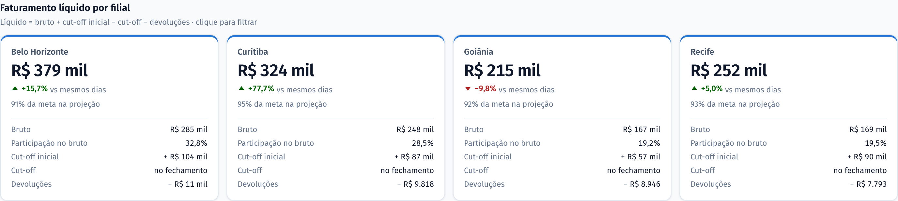
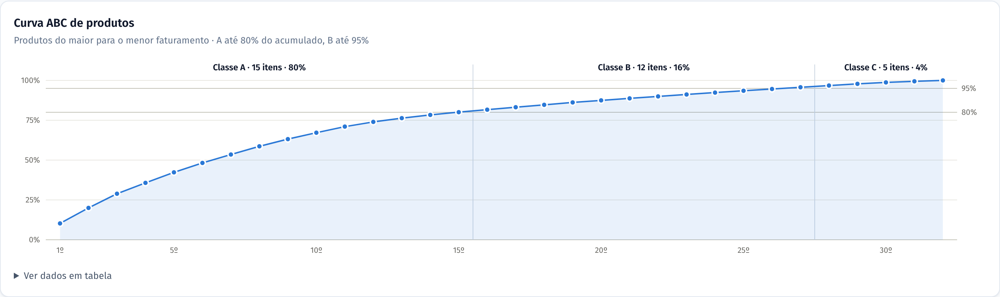
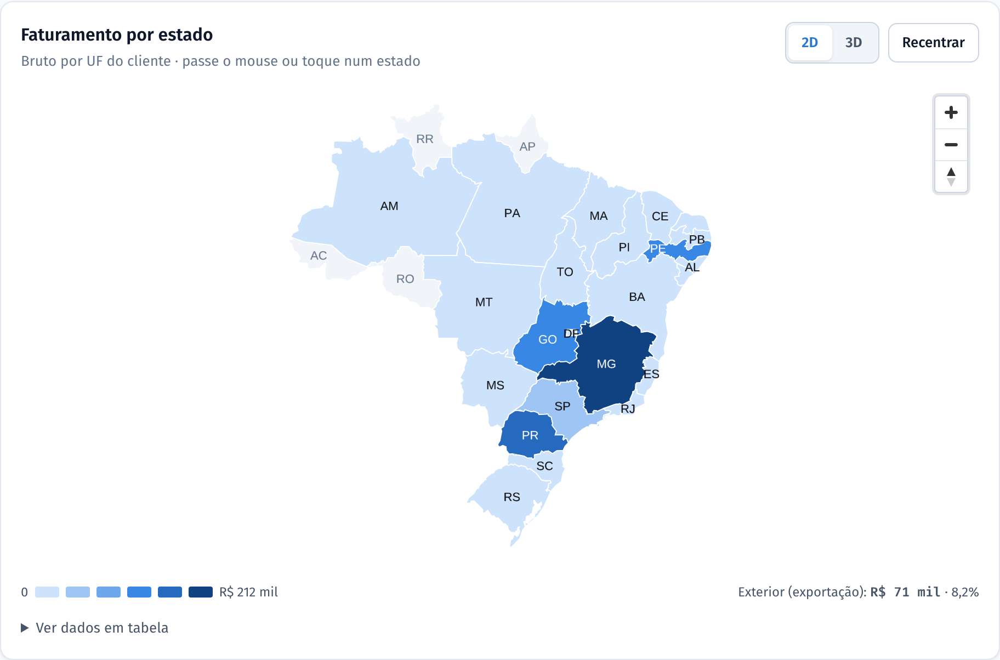
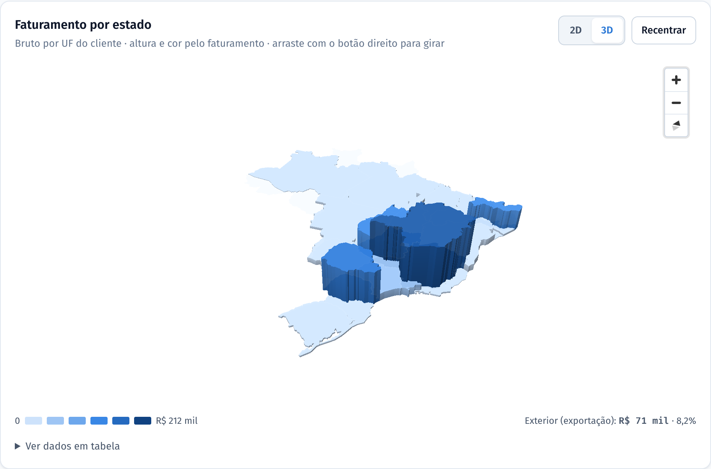
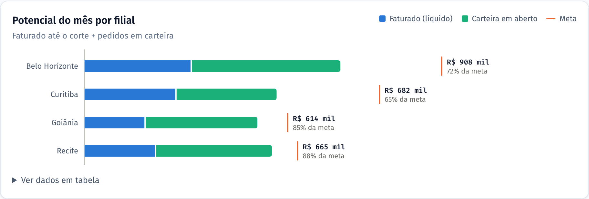

# Painel Comercial · Grão Norte Distribuidora

[](https://github.com/EduardoTorres92/painel-comercial/actions/workflows/ci.yml)

**Faturamento, meta e ritmo de vendas em uma tela só, atualizado a partir dos dados do ERP.**

> Projeto de portfólio. A Grão Norte Distribuidora é fictícia e todos os números foram gerados por um script, com padrões realistas de sazonalidade, crescimento, mix de produtos e devoluções.

🔗 **Demo:** [painel-comercial-demo.netlify.app](https://painel-comercial-demo.netlify.app/) · 📱 funciona no celular · 🌙 tema claro e escuro


---

## O problema

Em distribuidoras com várias filiais e canais, a pergunta do dia a dia é sempre a mesma: **"vamos bater a meta este mês?"**. A resposta costuma depender de planilhas montadas à mão a partir de relatórios do ERP, que:

- chegam atrasadas, quando já não dá tempo de reagir;
- comparam o mês em andamento (incompleto) com meses fechados, o que distorce qualquer variação;
- não mostram onde está o problema: qual filial, qual canal, qual produto.

## A solução

Um painel que transforma o relatório de vendas em respostas diretas:

| Pergunta do gestor | Onde o painel responde |
|---|---|
| Quanto cada filial faturou de fato? | **Card por filial** logo no topo: líquido, variação, bruto, participação, **cut-off inicial, cut-off e devoluções** |
| Vamos bater a meta? | **Projeção de fechamento** pelo ritmo dos dias úteis (com o cut-off), com status (no ritmo / perto / abaixo) |
| Estamos vendendo mais ou menos? | Variação **comparando os mesmos dias** do mês e do ano anteriores, não o mês inteiro |
| Qual filial está puxando para baixo? | Ranking de filiais contra a **meta proporcional** até hoje |
| Quanto ainda dá para faturar? | **Potencial do mês**: faturado + carteira de pedidos em aberto, contra a meta, e quanto falta em pedidos novos |
| Em quais produtos focar? | **Curva ABC**: quais produtos fazem 80% do faturamento |
| Onde estão os clientes? | **Mapa do Brasil interativo em 2D e 3D** (zoom, giro e inclinação), concentração regional e maiores clientes |
| Estamos entregando rápido? | **Lead time** do pedido à nota fiscal, em dias úteis, por filial |
| As devoluções estão sob controle? | Taxa por mês, **motivos**, filiais, canais e produtos com maior índice de devolução |
| Onde está aquela nota? | **Busca de notas fiscais** por número, cliente ou estado, com exportação para Excel (CSV) |

Os filtros de mês, filial e canal valem para todas as abas. Clicar numa filial, num canal ou num mês aplica o filtro, e a visão pode ser compartilhada por link (filtros e aba ficam na URL).

## O que tem no painel

| Aba | Conteúdo |
|---|---|
| **Visão geral** | Indicadores (líquido, meta, ticket, clientes, devolução), cards por filial com a composição do líquido, ritmo do mês com projeção, filiais vs meta, evolução de 12 meses e canais |
| **Produtos** | Curva ABC com as classes A/B/C, ranking completo e mix por categoria |
| **Clientes e regiões** | Mapa do Brasil (MapLibre) em 2D ou 3D, ranking de estados, maiores clientes e clientes ativos por mês |
| **Operação** | Carteira em aberto por situação, potencial do mês por filial, lead time (distribuição e por filial), notas acumuladas no mês e maiores pedidos em carteira |
| **Devoluções** | Taxa de devolução por mês, motivos, taxa por filial e canal e produtos com maior índice de devolução |
| **Notas fiscais** | Busca com paginação, ordenação e download em CSV |





<p>
  
  
</p>



<p>
  
  
</p>


## Como funciona

```
pipeline/gerar_dados.py        pipeline/transformar.py             web/ (React)
──────────────────────►  CSV  ─────────────────────────►  JSON  ─────────────►  painel
dados fictícios no             regras de negócio com pandas,        só lê e exibe:
formato de um ERP              agregadas por filial × canal × mês   indicadores e gráficos
```

- **Python + pandas (`pipeline/`)**: concentra as regras de negócio — faturamento bruto, devoluções na data da devolução, **cut-off** (notas emitidas no mês e entregues no seguinte), ticket médio, clientes ativos, lead time em dias úteis e potencial — e pré-calcula cada combinação de filtro. Num projeto real, `gerar_dados.py` é substituído pela leitura do relatório do ERP; o restante não muda.
- **React + TypeScript (`web/`)**: site estático, rápido e sem servidor. Cada aba baixa só os próprios dados, na primeira vez que é aberta (as notas fiscais, mês a mês). O navegador calcula só o que é de exibição: comparações, projeção, curva ABC e busca.
- **Gráficos em SVG feitos à mão**, sem biblioteca: barras de até 24 px com ponta arredondada, um eixo por gráfico, rótulos seletivos, tooltip em tudo e **versão em tabela** de cada gráfico.
- **Mapa com MapLibre GL JS**, sem mapa de fundo: só a malha dos estados (IBGE, simplificada para 267 KB), então não depende de servidor de tiles nem de chave de acesso. Cor em escala sequencial; no **3D** a altura de cada estado também é proporcional ao faturamento. Zoom, arrastar, girar e inclinar, dica ao passar o mouse e clique para fixar um estado. A biblioteca (1,1 MB) só é baixada quando a aba de clientes é aberta, e sem WebGL o painel volta para uma grade de estados.
- **Cores validadas para daltonismo** nos dois temas (azul = realizado, laranja = meta, verde-água = carteira), com status sempre acompanhado de ícone e texto. Na curva ABC, as classes são marcadas pela posição, não por tons de cor parecidos.

## A regra do faturamento líquido

```
líquido = bruto + cut-off inicial − cut-off − devoluções
```

- **Cut-off**: notas emitidas nos últimos dias do mês que só são entregues no mês seguinte. A receita é reconhecida na entrega, então esse valor sai do mês da emissão…
- **Cut-off inicial**: …e entra no mês seguinte (é o cut-off do mês anterior).
- No mês em andamento, o cut-off de saída só é apurado no fechamento. A projeção estima esse valor pela taxa de cut-off dos três meses anteriores.

## Qualidade

Números de painel precisam estar certos. Por isso o projeto tem duas camadas de teste, rodando no GitHub Actions a cada push:

- **Pipeline (pytest, 24 testes):** o total do painel fecha com os dados brutos; o cut-off fecha com as notas entregues no mês seguinte e só desloca receita entre meses; filiais e canais somam o total; o diário soma o mensal; produtos, estados e motivos somam o faturamento e as devoluções de cada mês; o lead time conta todas as notas (sem contar fins de semana); a carteira fecha por filial e situação; a geração é determinística.
- **Painel (Vitest, 31 testes):** contas conferidas à mão para ticket, taxa de devolução, **líquido com cut-off**, atingimento, **projeção pelos dias úteis**, comparação "mesmos dias", meta proporcional, **classificação ABC**, potencial, lead time e busca de notas (sem diferenciar acentos) com exportação em CSV.

## Como foi construído

Desenvolvido com **IA como copiloto** (Claude Code), com as decisões e a validação sob controle humano: cada regra de negócio tem teste; as cores passaram por um validador de acessibilidade; e o painel foi conferido em navegador real, no desktop e no celular, nos dois temas. A IA acelera a escrita; a responsabilidade pelos números continua sendo de quem entrega.

## Rodando localmente

Requisitos: Python 3.10+ e Node 22.12+.

```bash
pip install -r pipeline/requirements.txt
python -m pytest pipeline/tests          # testes do pipeline

cd web
npm install
npm run dados                            # gera os dados e os JSONs do painel
npm test                                 # testes do painel
npm run dev                              # http://localhost:5173
```

### Malha dos estados

`web/public/geo/` foi gerada uma vez a partir da malha estadual do IBGE, com o [mapshaper](https://github.com/mbloch/mapshaper):

```bash
npx mapshaper@0.7.97 br_states.json -filter-fields SIGLA,Estado -rename-fields uf=SIGLA,nome=Estado \
  -simplify 4% keep-shapes -o precision=0.001 format=geojson web/public/geo/brasil-uf.json
npx mapshaper@0.7.97 web/public/geo/brasil-uf.json -points inner -o format=geojson precision=0.01 \
  web/public/geo/brasil-uf-rotulos.json
```

## Publicando

O `netlify.toml` já está configurado: na Netlify, **Add new project → Import an existing project**, escolha este repositório e pronto. O build gera os dados, roda os testes e publica o site.

## Adaptando para a sua empresa

O painel foi pensado para ser reaproveitado: trocando o gerador de dados pela leitura do relatório de vendas do seu ERP (CSV ou Excel), os mesmos indicadores passam a mostrar a sua operação. Para dados sensíveis, ele também pode rodar só na rede interna, sem publicação na internet.

---

Feito por [Eduardo Torres](https://github.com/EduardoTorres92) · Licença [MIT](LICENSE)
